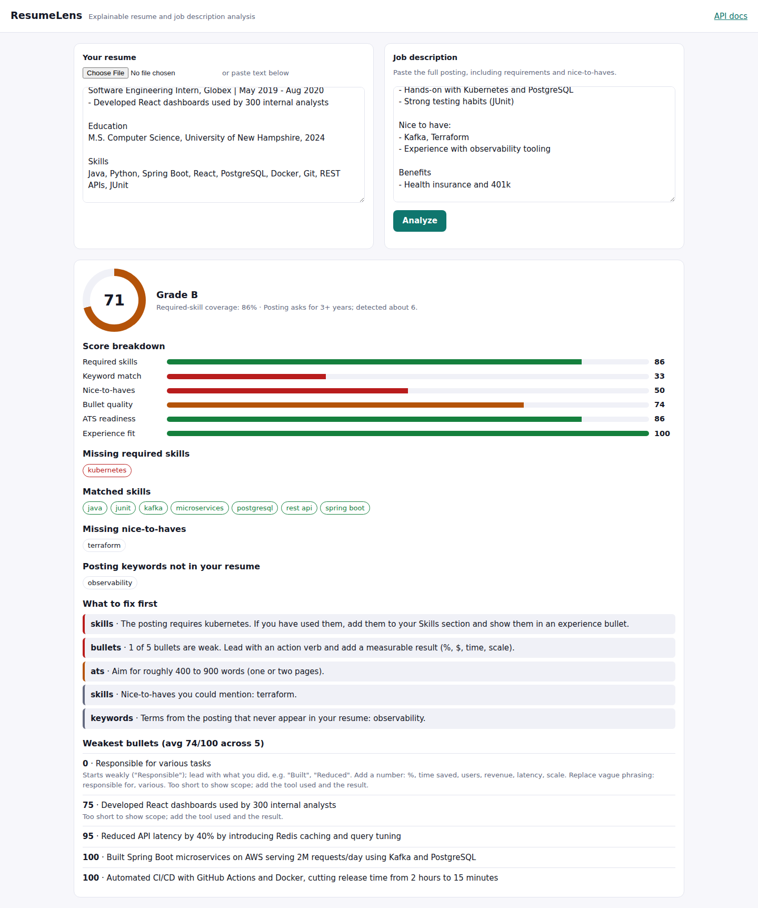

# ResumeLens

**Explainable ATS-style resume analysis.** Paste or upload a resume and a job description, and ResumeLens returns:

- a 0–100 score with a letter grade;
- a weighted breakdown showing *why* you got that score;
- the exact must-have skills you're missing;
- your weakest bullet points, with fixes;
- a prioritized list of what to change first.

   

Used by [JobPilot](https://github.com/si1051/jobpilot) to score every application, and works standalone with its own web UI.



## How the score works

| Signal | Weight | How it's measured |
|---|---|---|
| Required skills | 40% | Skills under "Requirements / Must have / Qualifications" headings, or flagged inline with "required", that your resume covers |
| Keyword similarity | 20% | TF-IDF (1–2 grams) cosine similarity between resume and posting |
| Nice-to-haves | 10% | Coverage of "Preferred / Nice to have / Bonus" skills |
| Bullet quality | 15% | Each bullet is scored for an action verb, quantified impact, vague phrasing, length and pronouns |
| ATS readiness | 10% | Contact info, standard section headings, sensible length, LinkedIn/GitHub |
| Experience fit | 5% | "N+ years" in the posting vs. years calculated from your dated roles (overlaps merged) |

A guardrail caps the score at 60 when fewer than half of the required skills match, so good formatting can't make up for a missing skill set.

## What makes it different

- **Requirement tiering:** reads the posting's own structure (required vs. preferred vs. benefits/about) instead of treating every word equally.
- **A taxonomy of 85+ skills with aliases:** `k8s` counts as Kubernetes and `Postgres` as PostgreSQL. Matching respects word boundaries, so "Java" never matches inside "JavaScript" and `C++`, `C#` and `.NET` are handled. Words that are also everyday English ("Go", "REST", "Express") only count in list context.
- **Bullet coach:** points out the weakest bullets and says exactly what's wrong ("Add a number…", "Replace vague phrasing: responsible for").
- **Explainable:** every number in the response can be traced to a rule. There's no black-box model.
- **File parsing:** reads PDF, DOCX (including table-based templates) and TXT, and detects scanned PDFs that contain no text.

## API

| Method | Path | Body |
|---|---|---|
| POST | `/api/v1/analyze` | `{"resume_text": "...", "job_description": "..."}` |
| POST | `/api/v1/analyze/file` | multipart: `resume` (PDF/DOCX/TXT ≤ 2 MB), `job_description` |
| POST | `/api/v1/skills/extract` | `{"text": "..."}` |
| GET | `/health` | Liveness |
| GET | `/docs` | Interactive OpenAPI docs |

Example response (trimmed):

```json
{
  "overall_score": 78,
  "grade": "B",
  "breakdown": {"required_skills": {"score": 80, "weight": 0.4}, "...": {}},
  "skills": {"missing_required": ["kubernetes"], "missing_preferred": ["terraform"], "required_coverage": 80},
  "experience": {"required_years": 3, "estimated_years": 6.0},
  "suggestions": [{"priority": "high", "area": "skills", "message": "The posting requires kubernetes..."}]
}
```

## Production concerns covered

- Per-IP sliding-window rate limiting (`429` with `Retry-After`), upload size limits and input length validation.
- Request IDs (`X-Request-ID`) and structured access logs with latency.
- CORS allow-list configured through environment variables.
- Non-root Docker image with a health check, and GitHub Actions CI covering lint, tests on Python 3.11 and 3.12, and the Docker build.
- The analysis engine (`app/engine`) is plain Python with no web framework dependency, so it's easy to unit test and reuse.

## Run it

```bash
python -m venv .venv && source .venv/bin/activate
pip install -r requirements-dev.txt
uvicorn app.main:app --reload       # UI at http://localhost:8000, docs at /docs
pytest                              # run the tests
```

Docker:

```bash
docker build -t resumelens . && docker run -p 8000:8000 resumelens
```

| Variable | Default |
|---|---|
| `CORS_ORIGINS` | `http://localhost:5173,http://localhost:3000` |
| `RATE_LIMIT_PER_MINUTE` | `60` |
| `MAX_UPLOAD_BYTES` | `2097152` |

## License

MIT © Sri Ram Teja Ialam
